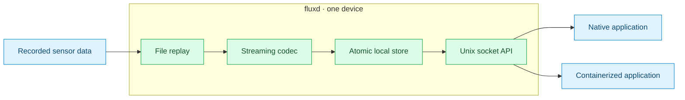

# fluxd

**Raw Earth Observation data → lossless encoding → durable local storage → local applications.**

A lightweight, offline Go daemon for optical, thermal, multispectral and hyperspectral acquisitions. Pure Go · bounded memory · Unix socket API · no runtime services.



> **CCSDS status:** the native B-1 subset passes local tests and 60 predictor/entropy reference fixtures. Full-file decoder interoperability is **not verified**. No general CCSDS compliance or flight qualification is claimed. [Compatibility matrix →](docs/ccsds.md)

## Run in three steps

Requires Go; CI uses 1.26, with a source language floor of 1.24. No third-party Go modules, CGO or external compression runtime.

```sh
# 1. Build and generate small optical/thermal replay fixtures.
make build
go run ./examples

# 2. Start the foreground daemon.
./bin/fluxd -config examples/config.json

# 3. In another terminal, inspect stored acquisitions.
./bin/fluxctl -socket ./fluxd.sock
./bin/fluxctl -op GetAcquisition -id optical-0001
```

Stop with **Ctrl+C** or **SIGTERM**. The example replays one optical file; select `thermal.raw` / `thermal.json` for thermal data. Restart with a new stable ID for another acquisition. Existing IDs are skipped.

## Three commands, three jobs

| Command | Purpose | Needed on the device? |
|---|---|---|
| `fluxd` | Ingest, compress, store and serve | **Yes** |
| `fluxctl` | List acquisitions, inspect metadata, check status | Optional |
| `fluxbench` | Measure throughput, ratio and resource usage | Development only |

Application consumers live in downstream projects. They receive compressed streams and must decompress and verify them before processing the restored samples. fluxd does not launch containers, schedule workloads or require cloud connectivity. Development reconstruction clients are provided in transport tests and `dev/consumer`; no production consumer is shipped.

## Capabilities at a glance

| Data | Storage & access | Compression |
|---|---|---|
| 8/10/12/14/16-bit integer precision | Atomic publication; SHA-256 checks | Native CCSDS 123.0-B-1 subset |
| Signed/unsigned; 8/16-bit containers | Restart recovery; capacity limits | Reduced P=0 column predictor |
| BSQ/BIL/BIP; explicit byte order | Bounded binary streams over Unix sockets | Sample-adaptive, lossless |

Packed 10/12/14-bit containers, physical sensor drivers, spectral/full prediction and block-adaptive coding are unsupported. `deflate` and `identity` remain explicit development/legacy codecs.

## Platform targets

| Device | Linux build | Validation |
|---|---|---|
| x86-64 development machine | `amd64` | Cross-build passes |
| Raspberry Pi 3, 32-bit OS | `arm`, `GOARM=7` | Cross-build passes |
| Pi 3/5, 64-bit OS; Jetson CPU | `arm64` | Cross-build passes |

Tests and recorded benchmarks ran on **macOS ARM64 / Apple M3**. Raspberry Pi/Jetson execution and performance are not yet measured.

## Explore the docs

[Latest baseline audit and measurements](benchmarks/baseline-2026-10-24/README.md): file-pipeline reconstruction verified; independent full-file CCSDS and containerd execution remain unverified.

| I want to… | Guide |
|---|---|
| Watch the pipeline in motion | [Standalone interactive explainer](docs/fluxd-explainer.html) |
| Understand the data flow and recovery | [Architecture](docs/architecture.md) |
| Configure replay, memory and disk limits | [Configuration](docs/configuration.md) |
| Run under systemd or diagnose startup | [Operations](docs/operations.md) |
| Build an external data consumer | [Local API](docs/api.md) |
| Inspect codec support and validation | [CCSDS codec](docs/ccsds.md) |
| Test, benchmark or extend fluxd | [Development](docs/development.md) · [Benchmarks](docs/benchmarks.md) |
| Check measured results and open gaps | [Verification](docs/verification.md) |

```sh
make lint test test-race test-cover cross
make benchmark
```

[Documentation index →](docs/README.md)
