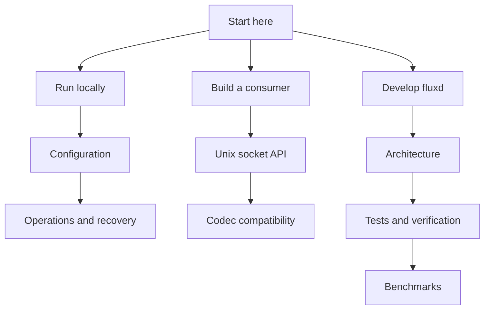

# Documentation

[← Project overview](../README.md) · [Animated standalone explainer](fluxd-explainer.html)

| Guide | What you will find |
|---|---|
| [Configuration](configuration.md) | Every daemon setting, raw descriptors, memory sizing |
| [Operations](operations.md) | Local replay, systemd, permissions, recovery, container access |
| [Architecture](architecture.md) | Boundaries, ownership, persistence and shutdown diagrams |
| [API](api.md) | Frames, operations, binary transfer and metadata |
| [CCSDS codec](ccsds.md) | Supported subset, decoder, memory and validation matrix |
| [Development](development.md) | Tests, extension points and source map |
| [Benchmarks](benchmarks.md) | Workloads, units, measurements and profiling |
| [Verification](verification.md) | Executed checks, coverage, known validation gaps |

Diagrams use Mermaid and render on GitHub; their source remains in Markdown.
