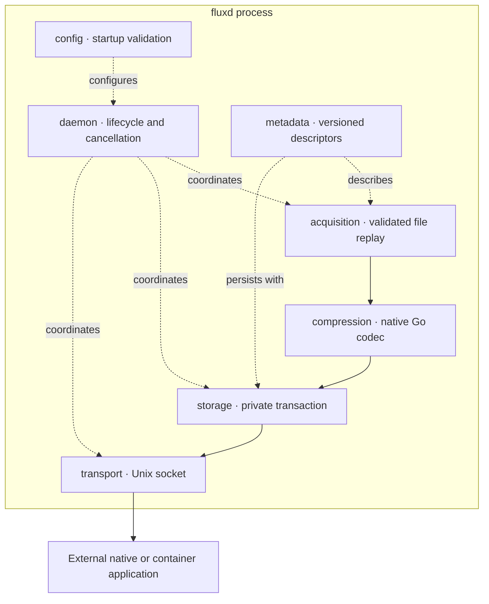
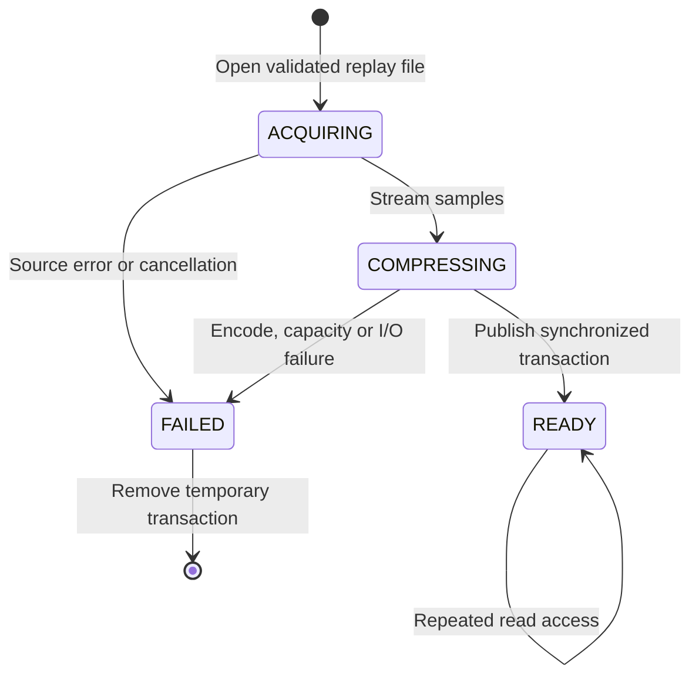
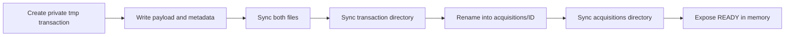
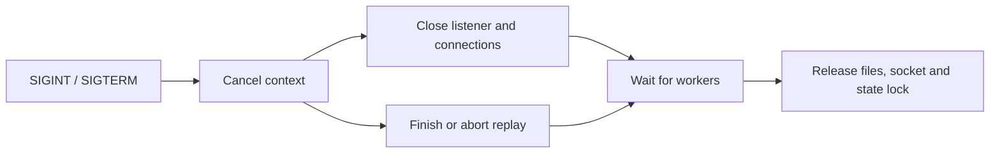

# Architecture

[Docs](README.md) / Architecture · [Storage operations →](operations.md)

## Component boundaries



| Boundary | Contract | Ownership / bound |
|---|---|---|
| Acquisition → codec | Context-aware reader → `io.Reader` | One caller-owned workspace; direct backpressure |
| Codec → store | Complete stream → `io.Writer` | One unit per acquisition; no full-image copy |
| Store → API | Immutable READY record + payload file | Serialized writer; bounded metadata index |
| API → application | JSON control frames + binary body | Capped clients, transfer buffers and deadlines |

Slow storage blocks compression, which blocks replay. No acquisition queue, chunk goroutine or shared-memory IPC is needed.

## Acquisition lifecycle



ACQUIRING/COMPRESSING overlap and are logged. Only READY records reach consumers; failed jobs have no durable history.

## Atomic publication



```text
state_dir/
├── .lock                     advisory process lock
├── acquisitions/<id>/
│   ├── payload               immutable encoded stream
│   └── metadata.json         descriptor + raw/encoded SHA-256
└── tmp/<transaction>/        never exposed to consumers
```

| Event | Behavior |
|---|---|
| Restart | Remove interrupted tmp entries; validate descriptors and hash published payloads |
| Corrupt record | Fail startup for operator repair; never silently discard it |
| Disk/capacity error | Abort transaction and return the error |
| Final directory sync failure | A complete record may remain for recovery; inspect before retrying its ID |
| Active reader | Keep its file open through transfer; no deletion/eviction API exists |

Durability assumes a local filesystem/device honoring atomic rename and fsync. Mutexes protect short index operations, not filesystem I/O. Recovery requires exclusive state ownership.

## Shutdown and trust boundary



Cancellation is checked between operations; regular file reads and fsync are not portably interruptible.

**Trust model:** one trusted service UID, protected state/socket directories, administrator-provided replay files. Files/socket are 0600; created state directories are 0700. Clients select validated IDs, never host paths. Same-UID clients are not mutually isolated. No container manager is required.
