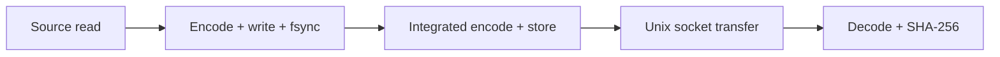

# Benchmarks

[Docs](README.md) / Benchmarks · [Recorded verification](verification.md)

## Current baseline

See the [2026-10-24 audit](../benchmarks/baseline-2026-10-24/README.md) for 1/8/32 MiB × 1/4/16-band measurements, gradient/noise patterns, raw JSONL, hardware details and exact verification limits. Reproduce with `python3 benchmarks/run-baseline.py benchmarks/local-baseline` after the Go checks.

`fluxbench -transport file` bypasses sockets and decodes directly from the stored payload. It verifies encoded/raw hashes and reconstructed length. This mode produces no socket transfer result. `-buffer` controls workspace; use `-buffer 1048576` for the supplied matrix. Both file and Unix modes report geometry, pattern, cache classification, wall time, CPU percent and logical payload I/O. `pipeline_latency_seconds` covers store publication through decode verification; it excludes the separate source/encode probes and container launch. Unix mode additionally includes a separate transfer before stored-file decoding, so it is not a continuous socket-to-decoder consumer measurement.

Logical reads per iteration are `3 × raw_bytes + encoded_bytes` in file mode (plus another encoded file read in Unix mode). Logical writes are `2 × encoded_bytes`. These exclude fixture generation, JSON metadata, filesystem journals and write amplification. **They are not physical disk I/O counters.** CPU% uses 100% per CPU core, and peak RSS is process-lifetime high-water, not per-stage memory. `BenchmarkHandlerPipe` measures handler/file/hash work over `net.Pipe`, not Unix sockets or containers.

## Choose a measurement

| Goal | Command | Output |
|---|---|---|
| Codec components + full encode/decode | `go test -bench=. ./internal/compression/...` | MB/s, samples/s, ratio, allocations |
| Default sustained pipeline run | `make benchmark` | Microbenchmarks + `benchmark.jsonl` |
| Larger, less compressible input | `./bin/fluxbench -bytes 268435456 -bands 16 -iterations 5 -pattern noise -codec deflate` | JSONL to stdout |

`fluxbench` defaults to CCSDS, three 64 MiB acquisitions. Use `gradient` / `noise`, vary sizes/bands, and compare `ccsds-123`, `deflate`, `identity`. It needs socket binding and disk space for raw input, a standalone encoded file and retained acquisitions.

## What each stage includes



These are **separate timed phases**, not exclusive contributions to one continuous acquisition.

| JSONL measurement | Interpretation |
|---|---|
| `source_seconds`, `source_mb_s` | Raw file replay into a discard sink |
| `compression_seconds`, `compression_mb_s` | Standalone encode, file write and sync |
| `storage_pipeline_seconds` | Encode + hashing + durable store; includes compression |
| `transport_seconds`, `transport_mb_s` | Encoded binary socket transfer |
| `decompression_seconds` | Decode stored payload and verify both hashes and raw length |
| `cpu_seconds`, `peak_rss_bytes` | Process CPU time; lifetime RSS high-water mark |
| `total_alloc_bytes`, `allocations` | Cumulative allocations during the iteration |

Fixture generation is streamed and excluded. CPU includes the local benchmark client/server. Warm caches and repeated iterations affect results. Application/container overhead remains unmeasured; the [development containerd guide](../dev/containerd/README.md) provides the next validation procedure.

## Read the units correctly

```text
compression ratio = original physical bytes / encoded bytes
raw MB/s          = original physical bytes / 1,000,000 / seconds
samples/s         = logical samples / seconds
```

Native codec benchmarks use 128×64 images, 1/16 bands, 8/12/16-bit effective precision, gradient/noise data and **16-bit raw containers**. Source data and workspace are allocated before timing; allocation counts are per operation, not retained heap or RSS.

## Recorded desktop example

**Apple M3 · macOS ARM64 · Go 1.24.2 · one band · 128×64 · 12-bit gradient in 16-bit containers**

| Encode | Decode | Ratio | Encode / decode allocations |
|---:|---:|---:|---:|
| 58.66 MB/s | 52.67 MB/s | 1.194 | 9 / 6 per acquisition |

[Full native results (JSONL)](../benchmarks/native-go-darwin-arm64.jsonl)

These synthetic desktop measurements are **not Raspberry Pi performance** or representative flight-sensor results. Local Unix socket end-to-end measurements remain blocked by socket-bind restrictions; the current baseline adds file-pipeline measurements.

## Milestone 2: Embedded systems characterization

Benchmark Raspberry Pi 3, Raspberry Pi 5 and Jetson on representative Earth Observation (EO) data, identifying CPU, memory and I/O bottlenecks.

1. **Prepare the devices.** Record the exact board/Jetson model, RAM, OS, kernel, Go version, source revision, storage device/filesystem, cooling and power mode. Build the same revision for each device and record CPU temperature and throttling during runs.
2. **Select representative EO inputs.** Use recorded optical, thermal, multispectral and hyperspectral acquisitions where available. Record provenance, dimensions, bands, precision, raw layout and file hashes. Include typical and large acquisitions; keep synthetic gradient/noise fixtures as a reproducible control. The existing baseline runner covers synthetic inputs only; use a replay harness for recorded data.
3. **Establish comparable baselines.** Run the same datasets, codec settings and buffer sizes on all three devices. Separate warm-cache and cold-cache runs, document the cache procedure, and repeat each case at least five times. Verify reconstructed samples and hashes for every acquisition; retain raw measurements and report median and range.
4. **Identify CPU limits.** Measure source replay, encode/store, transfer and decode throughput, latency and compression ratio. Collect CPU time, per-core utilization and CPU profiles; correlate slow stages with CPU saturation, clock changes and thermal throttling.
5. **Identify memory limits.** Record peak RSS, allocations, GC activity and swap activity during sustained replay. Vary acquisition size, band count and workspace size, including a 1 GB memory limit on supported configurations. Record failures and throughput degradation alongside memory use.
6. **Identify I/O limits.** Collect physical device throughput, utilization and latency with `iostat` alongside process I/O counters. Compare the normal storage device with a faster device where available, holding other settings fixed. Measure durable writes and Unix socket transfer separately; do not interpret logical payload byte counts as physical disk traffic.
7. **Publish the characterization.** Save commands, dataset manifests, device configurations, raw JSONL and profiles under a device-specific directory in `benchmarks/`. Produce a Pi 3 / Pi 5 / Jetson comparison of sustained throughput, latency, ratio, CPU, peak memory and physical I/O. Identify each bottleneck with profiling evidence and record recommended buffer sizes and operating limits. Mark the milestone complete only after all three devices have measured results.

## Target-device measurement checklist

| Scenario | Measure / record | Status |
|---|---|---|
| Idle | `pidstat -p PID 1 60`, `/proc/PID/status` | Not measured |
| Whole process | `/usr/bin/time -v`; CPU seconds versus wall time | Target run pending |
| 1 GB RAM | Sustained/repeated replay under a 1 GB cgroup | Not evaluated |
| Disk pressure | Capacity rejection; actual filesystem exhaustion | Logical limits tested; real ENOSPC pending |
| Small buffers / slow clients | Backpressure, workspace rejection, 30-second deadline | Tests cover behavior; hardware measurement pending |
| Native versus container | Identical data and hardware; downstream application | Not measured |

Record toolchain, kernel, CPU, filesystem/device and power mode with every hardware result. Cross-compilation is not hardware execution.
