# Native CCSDS codec

[Docs](README.md) / CCSDS · [Verification](verification.md)

**Pure Go · lossless · streaming · B-1 subset.** No CGO, external compression runtime or production subprocesses.

> **Validation boundary:** native tests and 60 independent predictor/entropy fixtures pass. Full-file decoder interoperability and official B-1 corpus validation remain **unverified**. Round trips alone do not establish CCSDS compliance.

## Supported configuration

| Feature | Implemented | Unsupported |
|---|---|---|
| Standard | [CCSDS 123.0-B-1, May 2012](https://ccsds.org/Pubs/123x0b1ec1s.pdf), with editorial corrections | B-2 / near-lossless |
| Samples | Signed/unsigned; 8/10/12/14/16-bit precision | Packed sub-byte containers |
| Physical input/output | 8/16-bit containers; little/big endian; signed extension | Silent masking, clipping or precision reduction |
| Dimensions/order | Each dimension 1..65536; BSQ/BIL/BIP | Intermediate BI depths |
| Predictor | Reduced, P=0, column-oriented sums | Full/spectral prediction, neighbor sums, custom weights |
| Entropy | Complete sample-adaptive mode | Block-adaptive mode, custom tables |
| Stream | 19-byte header, MSB-first codes, zero word fill | Chunk-level independent decoding |

The P=0 predictor has an **empty weight vector**: no adaptive weight update or spectral correlation is used. Other predictor modes fail explicitly.

## Encoder and decoder

```mermaid
flowchart LR
    RAW[Raw containers] --> READ[Read and validate samples]
    READ --> P[Column predictor]
    P --> R[Map residuals]
    R --> E[Sample-adaptive entropy]
    E --> B[Header + body + zero fill]
    B --> H[Parse header and limits]
    H --> DE[Decode residuals]
    DE --> DP[Reverse mapping and prediction]
    DP --> OUT[Reconstructed containers]
```



| Stream carries | Caller supplies |
|---|---|
| Dimensions, precision, signedness, encoded sample order | Raw container width and byte order |
| Predictor and entropy configuration | Resource ceilings and workspace |
| Output-word size and user-data byte | Optional expected acquisition descriptor |

The standalone decoder derives coding parameters from the header. With one band, BIL/BIP are physically equivalent; parsing BI depth 1 reports BIL.

## Default daemon profile

```text
codec     ccsds-123
standard  CCSDS 123.0-B-1
profile   reduced-p0-column-sample-adaptive-v1
mode      lossless
```

| Predictor parameters | Entropy parameters | Stream |
|---|---|---|
| P=0, reduced, column sums | Umax=18, gamma*=6, gamma0=1, K=3 | B=1 output byte |
| R=64, Omega=14, t_inc=64 | Per-band adaptive statistics | Default initialization |
| v_min=-1, v_max=3 | Unary/remainder + escape codes | No optional tables |

The internal Go API also supports Umax=8..32, gamma0=1..8, gamma*=max(4,gamma0+1)..9, K=0..min(D-2,14), output words 1..8 bytes and legal P=0 arithmetic parameters. These are **not additional daemon configuration fields**.

## Memory model

```text
workspace bytes = active_bands × (2 × width + 8)
active_bands    = 1 for BSQ; bands for BIL/BIP
additional I/O = two fixed 4 KiB buffers
```

One previous row plus entropy state lives in caller-owned workspace. Height/acquisition length does not grow working memory. There are no codec goroutines, queues or full-image copies.

| Standalone default ceiling | Value |
|---|---:|
| Raw/reconstructed bytes | 1 GiB |
| Encoded bytes | 4 GiB |
| Workspace | 4 MiB |

Zero/invalid limits fail. The backend adapter bounds each acquisition from its descriptor and the daemon's validated resource settings. Cancellation is checked before I/O and each sample; ordinary blocking file calls retain platform limitations.

## Source map for auditing

| File in `internal/compression/ccsds123/` | Responsibility | Standard reference |
|---|---|---|
| `config.go` | Ranges, formats, sizes, resource limits | Sections 3–5 |
| `header.go` | Encode/parse header; reject reserved/unsupported fields | Tables 5-1, 5-2, 5-3 |
| `predictor.go` | Column dependencies and reversible residual mapping | Sections 4.7, 4.9 |
| `entropy.go` | Initialization, code selection, rescaling, escape coding | Section 5.4.3.2 |
| `bits.go` | MSB-first fields and zero output-word fill | Section 5.4.3.2.3 |
| `encode.go`, `decode.go` | Separate bounded streaming control paths | Header + complete body |

P=0 reduces prediction to `2*previous+1` after the first sample. Residual mapping uses double-prediction parity and range boundaries. Arithmetic uses int32 sample calculations, int64 sizes and uint32 entropy state; no floating-point substitutions.

## Compatibility evidence

| Configuration | Native tests | Independent predictor/entropy fixtures | Independent full file |
|---|---|---|---|
| Default profile, 5 precisions × signed/unsigned × 3 layouts × 2 byte orders | Pass | **60 pass** | Not run |
| Alternate legal entropy/output-word parameters | Pass | Not independently checked | Not run |
| Full/spectral predictor or block-adaptive coding | Rejected | Unsupported | Unsupported |

The static vectors preserve independently generated predictor/entropy output with a **local B-1 header adapter**. [Fixture provenance →](../internal/compression/testdata/README.md)

**Integrity:** B-1 has no universal payload checksum. A bit flip may produce another valid stream; consumers must verify fluxd's encoded/raw SHA-256 metadata. The decoder rejects truncation, impossible residuals, invalid reserved fields, malformed padding, excess bytes and exceeded limits.

```sh
go test -cover ./internal/compression/...
go test -bench=. ./internal/compression/...
```


Remaining: independent full-file decoder validation, official B-1 vectors, target-hardware measurements, spectral/full prediction and block-adaptive coding. No broader compliance or flight-qualification claim is made.
