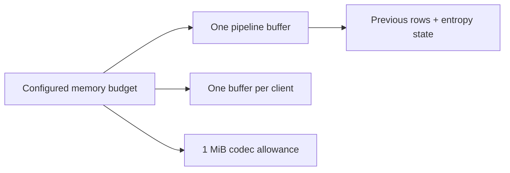

# Configuration

[Docs](README.md) / Configuration · [Run and operate →](operations.md)

**One strict JSON file.** Omitted fields inherit defaults. Unknown fields, trailing JSON and invalid limits fail startup. Paths are relative to the working directory; no environment variables are required.

```sh
./bin/fluxd -config examples/config.json
```

## Minimal replay configuration

```json
{
  "listen_socket": "./fluxd.sock",
  "state_dir": "./fluxd-state",
  "backend": "ccsds-123",
  "replay_file": "optical.raw",
  "metadata_file": "optical.json"
}
```

No replay paths means **serve existing acquisitions only**. Replay paths must be supplied together. There is no dynamic reload or path-based ingestion API.

## Settings reference

All sizes below are **bytes**, not MiB strings.

| Setting | Default | Constraint / meaning |
|---|---|---|
| `listen_socket` | `./fluxd.sock` | Socket in an operator-owned directory |
| `state_dir` | `./fluxd-state` | Private, exclusively locked state root |
| `log_level` | `info` | `debug`, `info`, `warn`, `error` |
| `backend` | `ccsds-123` | Native subset; alternatives: `deflate`, `identity` |
| `replay_file` | empty | Immutable, regular raw input file |
| `metadata_file` | empty | Strict schema-v1 raw descriptor |
| `replay_bytes_per_second` | `0` | Nonnegative; 0 disables pacing; first buffer may burst |
| `input_buffer_bytes` | `65536` | 1 KiB–4 MiB; codec workspace and each active transfer |
| `max_memory_bytes` | `8388608` | Budget for configured buffers + codec allowance |
| `max_acquisition_bytes` | `1073741824` | Positive; maximum physical raw acquisition size |
| `max_storage_bytes` | `4294967296` | Positive; compressed payload capacity |
| `max_clients` | `8` | 1–128; excess connections close |

Storage capacity excludes metadata and filesystem overhead. Capacity rejection preserves published acquisitions; automatic eviction is not implemented.

## Size the buffers



```text
Required configured budget ≥ input_buffer_bytes × (max_clients + 1) + 1 MiB

CCSDS workspace = active_bands × (2 × width + 8)
active_bands    = 1 for BSQ; bands for BIL/BIP
```

**Example:** width=1024, bands=4, BIL needs **8,224 workspace bytes**, fitting the default 64 KiB buffer. Height does not increase codec workspace.

> `max_memory_bytes` is **not an RSS ceiling**. Runtime/stacks, request frames (≤16 KiB/client), response encoding, the bounded 10,000-record index and OS cache are additional. Use OS/cgroup limits for a total process ceiling.

## Describe the raw samples

Generate examples with `go run ./examples`. Supply these input fields:

| Field | Accepted values |
|---|---|
| `schema_version` | `1` |
| `acquisition_id` | 1–128 characters; `[A-Za-z0-9][A-Za-z0-9_-]*` |
| `sensor_type` | `optical`, `thermal`, `multispectral`, `hyperspectral` |
| `timestamp` | Nonzero RFC3339 timestamp |
| `width`, `height`, `bands` | Positive; CCSDS additionally limits each to 65536 |
| `sample_bit_depth` | `8`, `10`, `12`, `14`, `16` |
| `storage_bit_depth` | `8` or `16`, at least the effective precision |
| `sample_type` | `uint` or `int`; signed containers must be sign-extended |
| `byte_order` | `little` or `big` |
| `layout` | `BSQ`, `BIL` or `BIP` |

```text
logical samples = width × height × bands
physical bytes  = logical samples × storage_bit_depth / 8
```

**12-bit measurements in 16-bit containers still occupy two bytes each.** Packed sub-byte formats are rejected. Size is checked before replay and during encoding; precision is never silently reduced.
