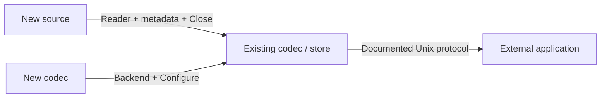

# Development

[Docs](README.md) / Development · [Architecture](architecture.md) · [Codec source map](ccsds.md#source-map-for-auditing)

## Find the code

```text
cmd/                         shipped commands: fluxd, fluxctl, fluxbench
internal/
├── acquisition/             context-aware raw file replay
├── compression/
│   └── ccsds123/             native codec and component tests
├── storage/                 atomic filesystem store
├── transport/               framed local API + test-only reconstruction client
├── metadata/                schema and sample-size validation
├── config/                  strict startup configuration
├── daemon/                  lifecycle and coordination
└── testutil/                deterministic test samples
packaging/systemd/           unprivileged service unit
```

## Everyday commands

| Command | Purpose |
|---|---|
| `make build` | Build the three commands |
| `make fmt` / `make lint` | Format / fail on formatting or vet findings |
| `make test` / `make test-race` | Unit/integration / race checks |
| `make test-cover` | Produce `coverage.out` |
| `make cross` | Pure-Go Linux amd64, arm64, ARMv7 builds |
| `make benchmark` | Component + sustained pipeline measurements |
| `make clean` | Remove generated build/coverage/benchmark outputs |

Builds and tests use only Go. CI includes build, formatting, vet, tests, race, coverage, fuzz smoke tests and cross-builds.

## Extend one boundary



| Extension | Implement | Preserve |
|---|---|---|
| Acquisition source | `Metadata`, `ReadContext`, `Close`; adapt with `acquisition.Reader` | Validated sizes, bounded caller buffers, cancellation; explicit overrun reporting |
| Compression backend | `Backend`; selection in `Select`; immutable binding in `Configure` | One complete stream per Encode, finalization errors, reproducible decode metadata |
| Native CCSDS settings | `Image`, `Config`, `RawFormat`, `Limits` | Header-driven decode; reject unsupported modes; independent test evidence |
| Consumer | [API protocol](api.md) in any language | Exact body length, codec selection, bounded output, both hashes, release |
| Future native/GPU backend | Isolated implementation behind Backend | Explicit device/buffer ownership and resource bounds |

Production consumers belong outside fluxd; no production SDK or consumer image is provided. Development-only validation tools live in [`dev/consumer`](../dev/consumer/main.go), [`dev/containerd`](../dev/containerd/README.md) and [`dev/interop`](../dev/interop/README.md). The independent codec runner requires an externally supplied adapter; neither external interoperability nor OCI runtime execution has passed yet. No device scheduler exists.

## Validation evidence

[Static codec vectors and license](../internal/compression/testdata/README.md) · [Verification status](verification.md)

The regression suite requires no external projects or runtimes. Complete independent B-1 file interoperability remains unverified; native round trips do not establish conformance. Do not expand compatibility claims without appropriate independent validation.
