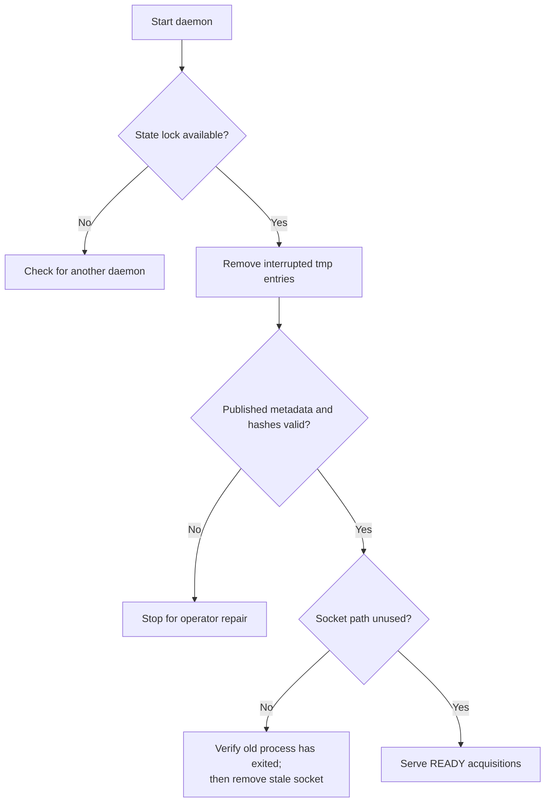
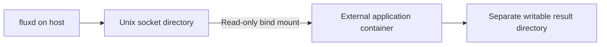

# Run and operate

[Docs](README.md) / Operations · [Configuration](configuration.md) · [API](api.md)

## Local replay

```sh
make build
go run ./examples
./bin/fluxd -config examples/config.json
```

| Task | Action |
|---|---|
| Replay thermal data | Set `replay_file` / `metadata_file` to `thermal.raw` / `thermal.json` |
| Replay another acquisition | Restart with a new stable ID and paired input paths |
| Serve stored data only | Leave both replay paths empty |
| Inspect data | `./bin/fluxctl -op ListAcquisitions` |
| Check service | `./bin/fluxctl -op GetStatus` |
| Stop gracefully | Ctrl+C, SIGINT or SIGTERM |

Input files must remain immutable. Reusing an existing ID skips replay; never assign that ID to different measurements.

## systemd deployment

Use the supplied [unit file](../packaging/systemd/fluxd.service). Provision these resources before starting it:

| Resource | Required setup |
|---|---|
| Account | Unprivileged `fluxd` user and group |
| Binary | `/usr/local/bin/fluxd` |
| Configuration | `/etc/fluxd/config.json` |
| Runtime | `/run/fluxd`, created by `RuntimeDirectory`, mode 0700 |
| State | `/var/lib/fluxd`, created by `StateDirectory`, mode 0700 |
| Replay input | Explicit read permission for the service account |

Set `listen_socket` to `/run/fluxd/fluxd.sock` and `state_dir` to `/var/lib/fluxd` in the deployment configuration. The unit applies `UMask=0077`, `NoNewPrivileges` and filesystem restrictions. It supervises a foreground process; fluxd does not daemonize itself.

## Recovery decisions



| Symptom | What to check |
|---|---|
| State already in use | Another process owns the advisory lock; it releases automatically on exit |
| Socket path already exists | Confirm the old daemon is gone before removing the stale socket |
| Integrity/recovery failure | Inspect the named acquisition and preserve evidence; corrupt data is not silently dropped |
| Capacity exceeded | Increase the configured limit or manage storage offline with no active consumers |
| Workspace too small | Use the [workspace formula](configuration.md#size-the-buffers) and increase the buffer/budget together |
| Consumer stalls/disconnects | Check UID, socket mount, client limit and 30-second operation deadline |

No automatic deletion/eviction or live repair API is implemented. A crash may require stale-socket cleanup before systemd restart succeeds.

## Container access



| Container requirement | Setting |
|---|---|
| Socket access | Bind-mount its parent directory read-only |
| Identity | Run with the service UID; provision access explicitly |
| Results | Separate writable mount owned by the application UID |
| Decoder | Match metadata codec, standard, profile and raw format |

The consumer image and its CLI belong to the downstream application project. fluxd ships no production consumer image and never launches containers. Containerd/OCI execution has not been validated locally.
