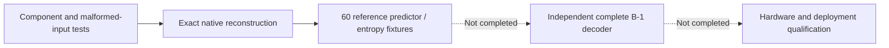

# Verification status

[Docs](README.md) / Verification · [Benchmark evidence](benchmarks.md)

**Execution host:** Apple M3, macOS ARM64, Go 1.24.2. **CI configuration:** Linux, Go 1.26; CI was not executed from this workspace.

## Latest baseline audit

The [2026-10-24 audit](../benchmarks/baseline-2026-10-24/README.md) records current code checks, 54 verified file-pipeline benchmark iterations, pipe-handler measurements and explicit environment blockers. Independent complete-file CCSDS and actual containerd validation remain **not run**. The package coverage figures below remain current; earlier fuzz evidence is historical and was not repeated in this audit.

## Checks executed

| Check | Result | Practical limit |
|---|---|---|
| Formatting + `go vet ./...` | **Pass** | No findings |
| `go test ./...` | **Pass with explicit skips** | Socket bind denied locally |
| `go test -race ./...` | **Pass with explicit skips** | Supported desktop host |
| `go test -cover ./...` | **Pass** | Coverage below |
| `make build lint cross` | **Pass** | Linux amd64, arm64, ARMv7; `CGO_ENABLED=0` |
| Module download / verification | **Pass** | No third-party Go modules |
| Five native codec fuzz targets | **Pass** | Two-second, two-worker smoke runs |
| Metadata, ID, size and frame fuzzing | **Pass** | Short smoke runs; not exhaustive |
| Codec/replay benchmarks | **Pass** | [Machine-readable results](benchmarks.md#recorded-desktop-example) |
| Optical/thermal fixture generation | **Pass** | Small deterministic synthetic inputs |
| `staticcheck`, containerd / ctr | **Not run** | Tools unavailable on host; Colima stopped |

Only `fluxd`, `fluxctl` and `fluxbench` are shipped commands. Dependency inspection found no `os/exec` or `runtime/cgo` in the production daemon.

## Core coverage

| Package | Line coverage | |
|---|---:|---|
| config | 100.0% | ██████████ |
| metadata | 100.0% | ██████████ |
| compression adapter / development codecs | 94.5% | █████████▍ |
| native `compression/ccsds123` | 92.2% | █████████▏ |
| daemon | 85.7% | ████████▌ |
| acquisition | 78.1% | ███████▊ |
| storage | 81.7% | ████████▏ |
| transport | 66.7% | ██████▋ |

Executable wrappers, generator and `testutil` have no standalone coverage. Transport remains below the 80% goal.

## What the evidence establishes



| Exercised locally | Still outstanding |
|---|---|
| Concurrent in-memory API transfers and checksums | Real Unix socket execution in an unrestricted environment |
| File replay → codec → store; restart and recovery behavior | Abrupt process-kill / power-loss testing |
| Interrupted transactions, invalid metadata, simulated capacity exhaustion | True ENOSPC injection |
| Header-driven decoding, reserved fields, truncation, limits, cancellation | Official independently produced B-1 corpus |
| Independent predictor/entropy fixtures; local B-1 header adapter | Full-file decoder interoperability |
| Pure-Go Linux cross-builds | Pi/Jetson execution, idle/RSS/1 GB/container measurements |

Static reference vectors retain their attribution and license. External implementation sources and decoder runners are not bundled. Complete independent B-1 file validation remains outstanding.

## Reproduce

```sh
make build lint test test-race test-cover cross
go test -bench=. ./internal/compression/...
```

Native fuzz targets: `FuzzHeader`, `FuzzDecode`, `FuzzEntropyDecode`, `FuzzConfig`, `FuzzSizes` in `./internal/compression/ccsds123`.

```sh
go test ./internal/compression/ccsds123 -run '^$' -fuzz FuzzDecode -fuzztime 10s
```

In the restricted workspace, checks used `GOCACHE=/tmp/fluxd-go-cache` and `GOPATH=/tmp/fluxd-go-path` because the default cache was unwritable. These overrides are environment-specific, not normal runtime requirements.

**No general CCSDS compliance, radiation tolerance or flight qualification is claimed.**
